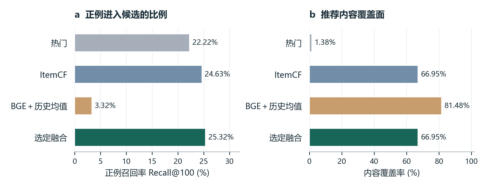
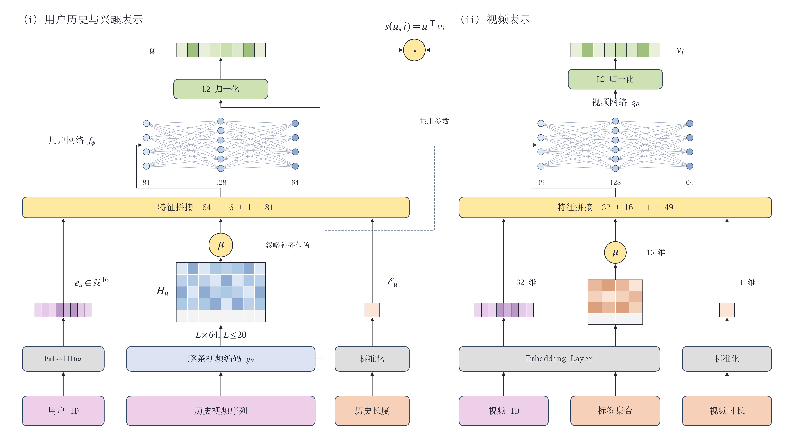
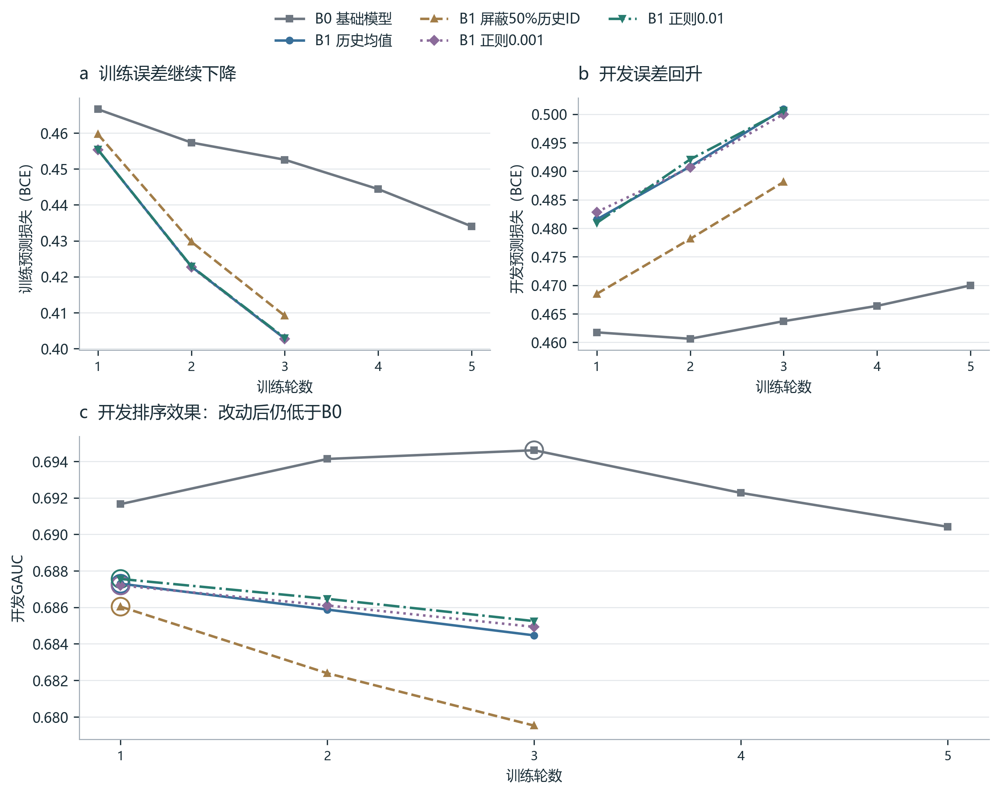

# GameFeed-Rec：内容推荐与游戏内容分析

使用 KuaiRand-Pure 与 KuaiRand-1K 展示日志，实现热门、ItemCF、双塔和 BGE 语义召回对照，训练观看达标与点赞预测模型，比较最终前10条推荐。项目使用短视频数据，单独分析游戏内容组。

## Pure：召回与行为预测

5,000名用户，272,354条展示记录，7,583条内容（其中739条游戏内容）。测试集按用户和日期划分为7,122组，每组推荐100条。

| 方法 | 测试 Recall@100 | 内容覆盖率 |
|---|---:|---:|
| 热门 | 22.22% | 1.38% |
| ItemCF | 24.63% | 66.95% |
| BGE＋历史向量均值 | 3.32% | 81.48% |
| 热门与ItemCF融合 | **25.32%** | **66.95%** |

融合比ItemCF提高0.69个百分点。按用户配对抽样2,000次，差值95%区间为[0.441, 0.941]个百分点。游戏组中融合29.62%、ItemCF29.91%。

独立观看达标、点赞模型测试AUC为0.7303、0.8375。加入当前模型排序后，测试Recall@10从4.71%降至3.23%，因此默认推荐按融合RRF分数排序。双塔与共享多任务作为对照。测试集曾用于此前迭代，以上为已有数据上的比较；神经模型使用单个随机种子。





## 1K：历史建模与改进对照

保留全部1,000名日志用户，常规训练、开发、测试分别为3,764,530、1,642,223和1,188,322条曝光。三种方法采用相同特征与三个配对种子，按开发GAUC选择最佳轮和最终方案。

| 方法 | 开发GAUC均值 | 测试GAUC均值 |
|---|---:|---:|
| B0：基础模型 | **0.69490** | **0.69076** |
| B1：最近20条历史取均值 | 0.68743 | 0.68705 |
| B2：按候选计算历史权重 | 0.68794 | 0.68795 |

最终采用B0。训练后期历史模型的损失下降、开发效果回落，因此进一步比较历史ID屏蔽与视频ID正则化。种子2026下，屏蔽50%历史ID使开发GAUC下降0.126个百分点；正则强度0.01提高0.026个百分点，95%用户抽样区间为[−0.025，0.080]个百分点，未达到预定的追加验证条件。



- [1K完整结果与三种子曲线](reports/kuairand_1k/full1000/experiment_results.md)
- [两次改进、对照表与最终取舍](reports/kuairand_1k/item_l2/history_followup_case.md)

Pure评价召回列表，1K评价实际曝光上的观看达标预测；两套实验分别报告。

## 先看报告

- [实验结果、结构图和公式](deliverables/GameFeed_实验结果图解.html)：下载后用浏览器打开，无需模型和数据。GitHub文件页面展示HTML源码。
- [模型结构图PDF](deliverables/GameFeed_模型结构图.pdf)
- [汇总实验报告](reports/release/experiment_summary.md)
- [提升来源与前10条评价](reports/release/final_evaluation/report.md)
- [指标分母与GAUC覆盖率](reports/release/interpretation_checks/report.md)

仓库保留汇总结果和图表，不包含原始数据、训练模型、逐用户推荐明细和浏览器配置。HTML内嵌JSON也已移除逐用户案例和视频原文列表。

## 安装与测试

在仓库根目录执行，建议使用Python 3.10或3.11：

```powershell
python -m venv .venv
.\.venv\Scripts\Activate.ps1
python -m pip install -e ".[semantic,report]"
python -m gamefeed.cli test
```

已有Python环境也可直接安装，依赖定义见 `pyproject.toml`。

## 下载数据并复现实验

1. 在 [KuaiRand官方页面](https://kuairand.com/) 获取数据说明，下载 [KuaiRand-Pure](https://zenodo.org/records/10439422)。将压缩包放到 `data/raw/kuairand/KuaiRand-Pure.tar.gz`，程序会解压。
2. 按官方仓库的补充数据链接，下载 `kuairand_video_captions.csv` 和 `kuairand_video_categories.csv`，放到 `data/raw/kuairand/supplement/`。
3. 按下面的顺序准备数据、训练和评价。数据与模型较大，训练耗时取决于硬件。

```powershell
python -m gamefeed.cli inspect --config configs/base.yaml
python -m gamefeed.cli prepare --config configs/base.yaml
python -m gamefeed.cli prepare-content --config configs/base.yaml

# 首次联网下载文本编码器，之后实验从缓存读取
python -c "from sentence_transformers import SentenceTransformer; SentenceTransformer('BAAI/bge-small-zh-v1.5')"

python -m gamefeed.cli validate-models --config configs/release.yaml
python -m gamefeed.cli train-ranker --config configs/release.yaml
python -m gamefeed.cli train-single-rankers --config configs/release.yaml
python -m gamefeed.cli optimize-fusion --config configs/release.yaml
python -m gamefeed.cli report --config configs/release.yaml
python -m gamefeed.cli analyze-groups --config configs/release.yaml --method selected --split test
```

完成上述步骤后，运行 `python -m gamefeed.cli serve --config configs/release.yaml`，打开 <http://127.0.0.1:8765> 查看模型演示。刚克隆仓库时，先阅读离线HTML；在线演示需要本地生成的模型和候选文件。

进一步检查最终列表、GAUC和BGE：

```powershell
python scripts/evaluate_release.py
python scripts/check_report_metrics.py
python scripts/audit_semantic.py
```

仓库保留主要报告、汇总JSON和PNG插图；公式图片、过程图、预览和重复格式由脚本生成。

重建已有汇总结果的图文报告：`python scripts/build_experiment_html.py`。中文图表使用系统中文字体，Windows支持微软雅黑和宋体；其他系统需安装中文字体并调整绘图脚本字体设置。

## 代码目录

| 位置 | 内容 |
|---|---|
| `src/gamefeed/data.py`、`history.py`、`samples.py` | 数据处理、历史构造与训练样本 |
| `features.py`、`vocab.py`、`datasets.py` | 特征、词表与训练批次 |
| `baselines.py`、`fusion_experiment.py` | 热门、ItemCF与多路融合 |
| `models.py`、`training.py`、`validation.py` | 双塔、行为预测与模型检查 |
| `text_retrieval.py` | 文本编码和语义召回 |
| `metrics.py`、`final_evaluation.py`、`report_checks.py` | 评价指标与分组分析 |
| `serving.py`、`web/` | 本地展示服务 |
| `configs/`、`scripts/`、`tests/` | 配置、运行脚本与测试 |
| `reports/release/`、`deliverables/` | 汇总结果和离线报告 |

## Pure评价方法

- 训练日期2022/4/8至4/21，开发4/22至4/28，测试4/29至5/8。
- 历史只读取前一天结束前最近20条观看达标记录；训练词表和模型只使用训练期数据。
- `long_view`：视频不超过18秒时看完，超过18秒时至少观看18秒；`is_like`表示点赞。
- Recall按用户和日期分组计算后平均；GAUC只包含同时有两类标签的用户，按其展示记录数加权。
- 前10条评价使用已观察观看达标正例，固定排序场景为tab=0、观看达标/点赞权重为0.7/0.3。
- 数据中的历史经过抽样；本项目按已保留记录构造历史。补充文案和类别作为静态内容特征使用。

## 参考资料

- [KuaiRand官方仓库与字段说明](https://github.com/chongminggao/KuaiRand)
- Gao et al., *KuaiRand: An Unbiased Sequential Recommendation Dataset with Randomly Exposed Videos*, CIKM 2022. [论文](https://doi.org/10.1145/3511808.3557624)
- [BGE-small-zh-v1.5模型说明](https://huggingface.co/BAAI/bge-small-zh-v1.5)

数据和预训练模型遵循各自发布方的许可。本仓库提供项目代码与实验汇总，数据请从官方来源获取。


## 复现1K历史建模

从KuaiRand官方来源下载KuaiRand-1K，解压至 `data/raw/kuairand_1k/KuaiRand-1K/data`。该目录应包含官方CSV文件。配置使用仓库相对路径；`configs/kuairand_1k_full.yaml` 保留全部用户，`kuairand_1k.yaml` 提供100用户流程检查设置。训练设备由 `model.device` 指定，默认CUDA；无兼容GPU时改为 `cpu`。

```powershell
python -m gamefeed.sequence_data --config configs/kuairand_1k_full.yaml
python scripts/run_sequence_full.py
```

流程依次训练B0、B1、B2的三个种子，按开发集选择模型，再统一评价测试集。最多5轮、连续2轮无改善即提前停止。进度保存在 `artifacts/kuairand_1k/full1000/run.log`，再次运行会复用结果记录、模型文件和开发预测均齐全的训练。仓库只附汇总结果，首次复现会正常训练。

主实验完成后，可复现两组开发集改进对照：

```powershell
python scripts/run_history_mask_trial.py
python scripts/run_item_l2_trial.py
```

`sequence_data.py`负责逐事件历史与样本，`sequence_model.py`定义三种模型，`sequence_training.py`负责训练与早停，`sequence_evaluation.py`负责分组评价与用户配对抽样。修改模型时可先运行 `python -m unittest discover -s tests`。

1K常规训练期为2022/4/22至5/1，开发期为5/2至5/5，测试期为5/6至5/8；更早记录用于积累历史。历史严格早于当前时间戳，同时间戳的记录互不进入历史。随机展示不更新历史，只用作补充评价。此前100用户流程实验包含部分相同测试记录，完整实验在主对照设置确定后统一评价。

离线HTML包含本次已完成实验的解释文字。`build_experiment_html.py`用于重建仓库所附结果；重新训练或更改设置后，以新生成的JSON和1K实验报告为准，并同步修改HTML中的解释文字。
