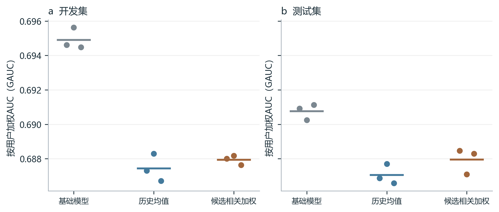
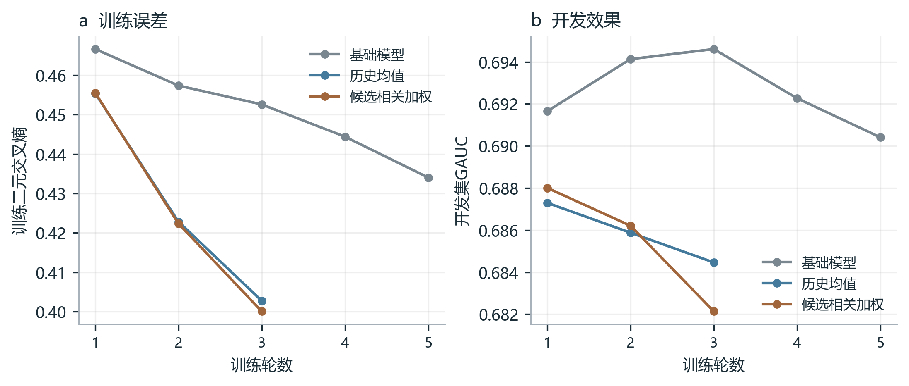
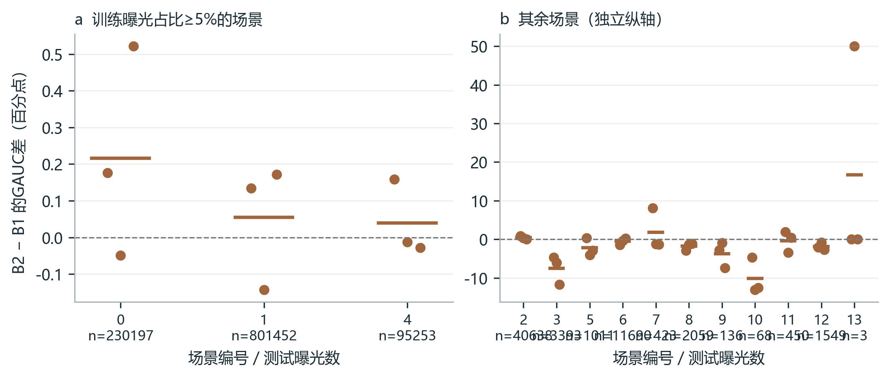

# KuaiRand-1K：历史建模实验结果

固定1000名用户，种子2026、2027、2028；每个模型最多5轮，依据开发GAUC选择检查点。

**开发集选择：B0（基础模型）。** 先记录选择，再评价测试集；不按测试结果重新调参。

## 主要结果

| 数据 | 模型 | AUC均值 | GAUC均值 ± 种子标准差 | LogLoss均值 |
| --- | --- | ---: | ---: | ---: |
| 开发常规 | S0用户场景倾向 | 0.77601 | 0.61428 | 0.47350 |
| 开发常规 | B0 基础模型 | 0.79475 | 0.69490 ± 0.00063 | 0.46259 |
| 开发常规 | B1 历史均值 | 0.78588 | 0.68743 ± 0.00081 | 0.48382 |
| 开发常规 | B2 候选相关加权 | 0.78793 | 0.68794 ± 0.00028 | 0.47737 |
| 测试常规 | S0用户场景倾向 | 0.77261 | 0.60903 | 0.47631 |
| 测试常规 | B0 基础模型 | 0.79002 | 0.69076 ± 0.00046 | 0.46711 |
| 测试常规 | B1 历史均值 | 0.78350 | 0.68705 ± 0.00058 | 0.48612 |
| 测试常规 | B2 候选相关加权 | 0.78547 | 0.68795 ± 0.00075 | 0.47975 |
| 开发随机 | S0用户场景倾向 | 0.69886 | 0.50021 | 0.54661 |
| 开发随机 | B0 基础模型 | 0.71343 | 0.56155 ± 0.01173 | 0.56519 |
| 开发随机 | B1 历史均值 | 0.70636 | 0.56773 ± 0.00752 | 0.58924 |
| 开发随机 | B2 候选相关加权 | 0.70651 | 0.56060 ± 0.00994 | 0.56840 |
| 测试随机 | S0用户场景倾向 | 0.68550 | 0.50000 | 0.53270 |
| 测试随机 | B0 基础模型 | 0.69852 | 0.56867 ± 0.00191 | 0.55371 |
| 测试随机 | B1 历史均值 | 0.69487 | 0.58269 ± 0.00238 | 0.57862 |
| 测试随机 | B2 候选相关加权 | 0.69653 | 0.57963 ± 0.00292 | 0.55664 |



每个点是一次训练，横线是三次均值；非集成预测。图中全部种子均展示。

## 加权相对均值的差异

| 数据 | 曝光数 | 用户数 | 正例率 | GAUC差（百分点） | 用户抽样95%区间 |
| --- | ---: | ---: | ---: | ---: | --- |
| dev_standard | 1642223 | 986 | 25.92% | 0.051 | [0.001, 0.098] |
| dev_random | 14333 | 907 | 9.05% | -0.714 | [-1.522, 0.142] |
| test_standard | 1188322 | 978 | 25.96% | 0.090 | [0.029, 0.163] |
| test_random | 12366 | 857 | 8.38% | -0.306 | [-1.286, 0.689] |

GAUC有效评价范围（所有模型使用同一批标签）：
- dev_standard：有效用户979/986，有效曝光1641623/1642223（99.96%）。
- dev_random：有效用户441/907，有效曝光10472/14333（73.06%）。
- test_standard：有效用户970/978，有效曝光1188287/1188322（100.00%）。
- test_random：有效用户399/857，有效曝光8794/12366（71.11%）。

按用户配对抽样2,000次，保留用户全部记录；每次先计算三个种子的差，再取均值。区间描述评价用户变化对这三次训练平均差值的影响。

## 每个种子与计算成本

| 模型／种子 | 最佳轮 | 开发GAUC | 测试GAUC | 总训练秒数 | 峰值显存MiB |
| --- | ---: | ---: | ---: | ---: | ---: |
| B0／2026 | 3 | 0.69461 | 0.69091 | 1795.4 | 1112.4 |
| B0／2027 | 3 | 0.69563 | 0.69024 | 1801.0 | 1112.4 |
| B0／2028 | 2 | 0.69448 | 0.69113 | 1538.2 | 1112.4 |
| B1／2026 | 1 | 0.68730 | 0.68686 | 1372.8 | 1112.4 |
| B1／2027 | 1 | 0.68830 | 0.68770 | 1403.2 | 1112.4 |
| B1／2028 | 2 | 0.68670 | 0.68658 | 2181.4 | 1112.4 |
| B2／2026 | 1 | 0.68801 | 0.68846 | 1421.7 | 1112.5 |
| B2／2027 | 1 | 0.68817 | 0.68709 | 1443.9 | 1112.5 |
| B2／2028 | 1 | 0.68763 | 0.68829 | 1639.7 | 1112.5 |

| 模型 | 参数量 | 训练进程峰值MiB（种子2026） | 测试批量预测秒数均值 |
| --- | ---: | ---: | ---: |
| B0 | 54,780,513 | 3414.0 | 28.59 |
| B1 | 54,780,513 | 3434.3 | 18.23 |
| B2 | 54,784,674 | 3434.3 | 16.38 |

预测耗时覆盖测试常规曝光的分批特征组装、传入GPU、模型前向和取回分数；不包含模型加载与指标计算。批次256，三个种子的耗时取均值；它是批量离线耗时。



学习曲线显示种子2026的全部已运行轮次；其他两种子逐轮结果在JSON中。

## 场景与有效评价覆盖



按训练曝光占比5%划分两个面板，纵轴分别显示；n为该场景测试曝光数。每个点是一对相同种子的差值，横线为均值。小样本场景的GAUC可能大幅跳动；无有效正负组的场景只在下表报告覆盖。

| 场景 | 曝光数 | 正例率 | 有效用户比例 | 有效曝光比例 | B0 GAUC | B1 GAUC | B2 GAUC |
| --- | ---: | ---: | ---: | ---: | ---: | ---: | ---: |
| 0 | 230197 | 3.96% | 73.11% | 98.36% | 0.55480 | 0.54853 | 0.55070 |
| 1 | 801452 | 30.83% | 98.86% | 99.99% | 0.61965 | 0.61516 | 0.61570 |
| 2 | 40638 | 29.18% | 92.05% | 99.91% | 0.62957 | 0.61775 | 0.62180 |
| 3 | 3393 | 0.27% | 2.29% | 2.65% | 0.51435 | 0.64676 | 0.57215 |
| 4 | 95253 | 40.96% | 88.30% | 99.61% | 0.59441 | 0.59356 | 0.59395 |
| 5 | 1011 | 9.99% | 55.77% | 83.48% | 0.56298 | 0.57223 | 0.55055 |
| 6 | 11690 | 6.76% | 43.71% | 64.98% | 0.60130 | 0.57598 | 0.57062 |
| 7 | 423 | 33.33% | 46.67% | 82.98% | 0.53325 | 0.55130 | 0.56981 |
| 8 | 2059 | 1.80% | 23.68% | 57.84% | 0.46832 | 0.54191 | 0.52435 |
| 9 | 136 | 26.47% | 31.25% | 89.71% | 0.57916 | 0.56853 | 0.53171 |
| 10 | 68 | 66.18% | 30.00% | 82.35% | 0.71313 | 0.60871 | 0.50788 |
| 11 | 450 | 17.33% | 42.86% | 64.00% | 0.65324 | 0.63092 | 0.62741 |
| 12 | 1549 | 7.62% | 29.41% | 91.67% | 0.52579 | 0.49744 | 0.47912 |
| 13 | 3 | 33.33% | 100.00% | 100.00% | 0.16667 | 0.00000 | 0.16667 |

## 内容与历史分组

| 分组 | 曝光数 | 正例率 | B0 GAUC | B1 GAUC | B2 GAUC |
| --- | ---: | ---: | ---: | ---: | ---: |
| 词表内视频 | 282762 | 28.64% | 0.66871 | 0.66492 | 0.66644 |
| 词表外视频 | 905560 | 25.12% | 0.69531 | 0.69202 | 0.69250 |
| 视频时长≤15秒 | 430555 | 25.77% | 0.71150 | 0.70770 | 0.70818 |
| 视频时长15—60秒 | 320946 | 24.17% | 0.66414 | 0.66151 | 0.66326 |
| 视频时长>60秒 | 436821 | 27.45% | 0.65175 | 0.64949 | 0.65019 |
| 历史1—5条 | 18 | 11.11% | 0.66667 | 0.43750 | 0.34375 |
| 历史6—19条 | 53 | 32.08% | 0.50529 | 0.53704 | 0.51918 |
| 历史20条 | 1188251 | 25.96% | 0.69077 | 0.68705 | 0.68795 |

分组词表只使用截至5月1日的常规日志；实际向量训练覆盖另见下表。历史分组按每条曝光当时可用的历史计算，上限20条。

## 输入覆盖与解释

| 模型 | 开发候选词表覆盖 | 开发候选实际训练覆盖 | 开发历史实际训练覆盖 | 开发候选标签覆盖 |
| --- | ---: | ---: | ---: | ---: |
| B0 | 34.07% | 30.13% | 34.24% | 96.96% |
| B1 | 34.07% | 30.16% | 34.28% | 96.96% |
| B2 | 34.07% | 30.16% | 34.28% | 96.96% |

## 历史反馈延迟检查

测试集有85284条记录的最近20条历史包含可能尚未结束的观看。用“曝光时间＋记录的播放时长”作为保守完成时间，遮蔽这些历史条目，再用原模型预测。历史长度数值特征保持原值，也不补入更早的历史。

| 模型 | 原GAUC均值 | 遮蔽后GAUC均值 | 差值（百分点） |
| --- | ---: | ---: | ---: |
| B1 | 0.68705 | 0.68702 | -0.002 |
| B2 | 0.68795 | 0.68792 | -0.003 |

这是固定模型的输入敏感性检查；真实反馈上报时间未在日志中给出。

## 模型和指标怎么理解

- S0：根据用户和场景过去的观看达标比例打分。同一个用户、同一个场景下，所有视频分数相同，所以同时有正负例时，该组AUC为0.5。总体GAUC还会受到不同场景比例影响。
- B0：输入用户、候选视频ID和标签、场景、时刻、视频时长及历史长度，使用多层全连接网络（MLP）预测观看达标概率。
- B1：在B0输入基础上，增加最近20条观看达标历史的平均内容向量。
- B2：输入相同，改为让当前候选参与计算每条历史的权重，再加权求和。借鉴DIN（Deep Interest Network，深度兴趣网络），本实现使用softmax归一化权重。

$$
h_{\mathrm{mean}}=\frac{1}{L}\sum_{j=1}^{L}h_j,\qquad h_{\mathrm{weighted}}=\sum_{j=1}^{L}\alpha_jh_j
$$

$$
\alpha_j=\frac{\exp(g(h_j,v,h_j-v,h_j\odot v))}{\sum_{k=1}^{L}\exp(g(h_k,v,h_k-v,h_k\odot v))}
$$

L是有效历史条数，h是历史视频向量，v是当前候选向量；g是小型神经网络，⊙表示对应位置相乘。补位条目的权重为0，空历史输出全零向量。

- AUC：随机取一条观看达标和一条未达标记录，模型把达标记录排在前面的比例，平分计0.5。
- GAUC：先分别计算每个用户的AUC，再按有效用户的曝光记录数加权。只有单一标签的用户不参与计算，覆盖率单独报告。
- LogLoss：二元交叉熵；概率判断越准确，数值通常越小。
- 种子标准差：三次训练结果的波动；用户抽样区间：固定这三次训练，改变评价用户组成时的差值波动。

$$
\mathrm{GAUC}=\frac{\sum_{u\in U_{\mathrm{valid}}}n_u\mathrm{AUC}_u}{\sum_{u\in U_{\mathrm{valid}}}n_u}
$$

n是该用户的曝光记录数，U_valid是同时有正负例的用户集合。

## 结论与范围

1. 预先按开发集选择基础模型。测试阶段保持该决定；B2相对B1的测试GAUC差为0.090个百分点。
2. 配对用户抽样区间全部高于零，这三次训练支持加权优于均值。
3. ID覆盖较低时，标签表示承担更多内容区分；词表存在不等于向量得到训练。未参与训练的ID向量统一使用零回退，保留可用标签。
本轮标签词表为58种。结合训练曲线、输入覆盖和场景分组解释差异；这些对照分别描述优化过程、可用信息和适用人群。
4. 本轮保留全部1000名日志用户，包括历史积累期之后首次出现的用户。数据按紧凑类型保存，相同标签组合只解析一次；实际资源占用见上表。
5. 日期统一采用time_ms换算的上海日期，原date保留；历史严格早于当前时间。先前反馈视为已可用，潜在时间重叠数量见数据检查。
6. 当前评价的是实际曝光上的观看达标预测，不等同于新召回列表或游戏业务的线上收益。游戏映射未完整验证，未给数字标签随意命名。
7. 可选50／100条历史、全库召回与多任务不属于本轮必做；先保留可解释的主对照结果。

## 交付与复现

汇总JSON包含三个种子的完整曲线、各场景、已知／未见视频及视频时长分组。

本图为定量比较图：三种子表现、训练过程和同场景差值分别回答三个问题。数据源为同目录experiment_results.json；没有删除任何种子。PNG供阅读，SVG/PDF保留可编辑文本。

参考：[KuaiRand数据说明](https://kuairand.com/)、[DIN论文](https://arxiv.org/abs/1706.06978)。结果均来自本地实验。

```powershell
$env:PYTHONPATH = Join-Path $PWD src
python -m gamefeed.sequence_training --config configs/kuairand_1k_full.yaml --seed 2026
# 同样运行2027、2028后：
python -m gamefeed.sequence_evaluation --config configs/kuairand_1k_full.yaml
python scripts/report_sequence_experiment.py --report-dir reports/kuairand_1k/full1000
```

## 历史模型后续排查（2026-11-04）

保持原三种子主实验结果，继续采用B0。后续种子2026对照中，屏蔽50%历史ID使开发GAUC下降0.126个百分点；视频ID正则0.01提高0.026个百分点，用户抽样95%区间为[−0.025，0.080]个百分点，未达到追加验证条件。

[查看完整排查案例、对照表和训练曲线](../item_l2/history_followup_case.md)。
