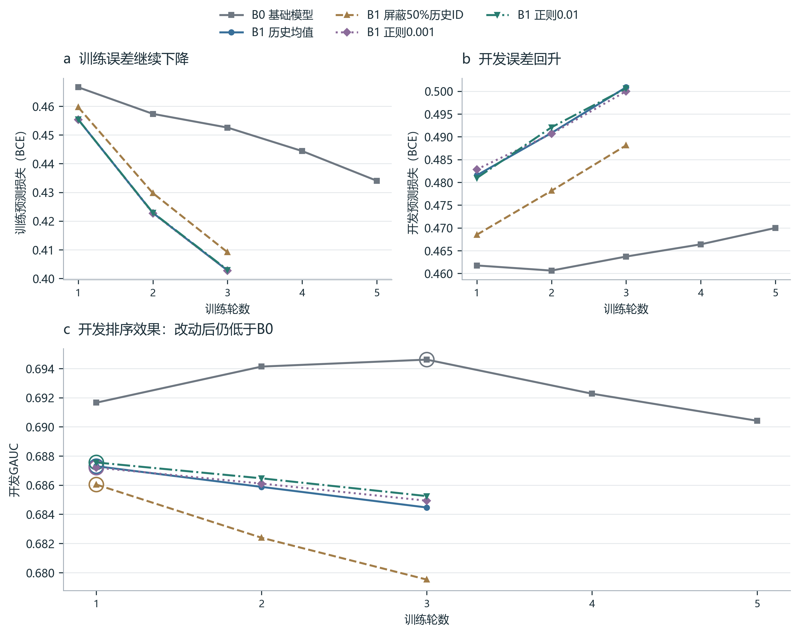

# 历史模型效果下降：两次改进与最终取舍

两次改进尝试完成后，继续采用B0基础模型。屏蔽历史ID降低了排序效果；较强正则带来小幅提高，但未达到追加验证条件。

## 对照结果

本表统一使用种子2026和同一批1,642,223条常规开发曝光。差值区间按用户配对抽样2,000次，保留每个用户的全部记录；它描述本次训练下的用户抽样波动。原三种子主实验另行报告。

| 方案 | 最佳轮 | 开发GAUC | 开发预测损失 | 相对原B1变化（百分点） | 95%区间（百分点） |
| --- | ---: | ---: | ---: | ---: | --- |
| B0 基础模型 | 3 | 0.69461 | 0.46371 | — | — |
| B1 历史均值 | 1 | 0.68730 | 0.48154 | — | — |
| B1 屏蔽50%历史ID | 1 | 0.68604 | 0.46849 | -0.126 | [-0.202, -0.050] |
| B1 正则0.001 | 1 | 0.68720 | 0.48285 | -0.010 | [-0.061, 0.043] |
| B1 正则0.01 | 1 | 0.68755 | 0.48094 | +0.026 | [-0.025, 0.080] |

## 训练曲线

种子2026，展示五组训练的全部已运行轮次。上方分别为训练与开发的预测损失BCE，均不含正则项；下方为开发GAUC。圆环标出各组按开发GAUC选中的轮次。线段连接实际观测值，纵轴范围按指标分别设置。

## 排查过程

### 发现问题

B1训练预测损失从0.45539降至0.40276，开发GAUC从0.68730降至0.68446；B1第一轮也低于B0第一轮的0.69165。因此，后续过拟合是已观察现象，第一轮的模型差距还需要单独解释。

### 检查输入

开发历史中，约34.28%的条目能使用经过训练的ID向量，候选中约30.16%。其余ID使用零向量并保留标签。这个覆盖差异提供了排查方向。

### 尝试一：屏蔽ID

训练时随机屏蔽50%的历史视频ID向量，保留标签、历史长度和有效位置。开发预测损失从0.48154降到0.46849，但GAUC下降0.126个百分点。概率误差改善与组内排序改善是两个目标。

### 尝试二：保留ID并加正则

对当前批次实际使用的视频ID向量加L2惩罚，限制参数过度拟合。0.001和0.01两组都在第一轮达到最佳开发GAUC；0.01提高0.026个百分点，差值区间包含零。

### 最终取舍

事先约定至少提高0.05个百分点且区间下界高于零，才补另外两个种子和同正则的B0。两组均未达到条件，本轮结束，继续采用B0。

## 正则化的计算

$$
L_{\mathrm{total}}=L_{\mathrm{BCE}}+\lambda\frac{1}{|S|d}\sum_{i\in S}\sum_{j=1}^{d}E_{ij}^{2}
$$

S是本批次去重后的有效视频ID集合，d=16为ID向量维度，E是视频ID向量表，λ为正则强度。S为空时惩罚为0。这个批次内平方均值方法与DIN按频率修正的MBA不同。
训练日志分别记录BCE、加权正则项和总目标；开发预测损失只计算BCE。数据划分、学习率、20条历史、批次大小和提前停止规则保持一致。

## 面试时如何讲

**问题：你遇到了什么问题，怎么排查？**

答案：加入最近20条历史后，模型在训练集上拟合得更好，开发排序效果却下降。我先检查学习曲线和ID覆盖，再做屏蔽历史ID、视频ID正则化两类对照。前者降低了GAUC，后者只有小幅变化，因此保留基础模型。

**问题：为什么预测损失下降，GAUC却下降？**

答案：预测损失考察概率与标签的偏差；GAUC考察同一用户下正例是否排在负例前面。屏蔽ID后，概率整体变小，大量负例的误差下降，但正负例的先后关系没有随之改善。

**问题：这个正则化具体怎么实现？**

答案：把当前批次的候选ID与有效历史ID合并去重，排除补位和未知ID，对所取向量各坐标的平方求平均，乘以0.001或0.01后加到预测损失上。候选与历史共享向量表，所以两部分都会受到影响。

**问题：为什么不再多跑几个参数？**

答案：本轮验证的是两种针对性修改。较好设置只提高0.026个百分点，仍落后原B0约0.706个百分点，也没有达到事先约定的追加条件。因此先完成记录和交付，后续研究再提出新的假设。

**问题：这次能确定主要原因了吗？**

答案：已确定的是训练后期过拟合、开发ID覆盖较低，以及两种改动的实际结果。正则化和屏蔽没有明显解决差距，说明当前证据还不足以确定主要原因。

## 数据与复现

训练3,764,530条曝光；全部实验最多5轮，连续2轮开发GAUC未改善即停止。新实验只使用开发集选择设置；本轮没有追加种子或测试评价。
原三种子主实验的B0开发GAUC均值为0.69490、测试均值为0.69076；上表0.69461是种子2026的开发结果。Pure融合Recall@100属于另一套实验。
运行 `python scripts/report_history_followup.py` 可从原始汇总JSON重建本案例、表格与曲线，无需重新训练。CSV提供全部轮次，SHA-256清单记录来源；五组共有17个轮次点，全部展示。
参考：[DIN原论文，第5.1节和表4](https://arxiv.org/html/1706.06978)。本表数值均来自本项目实验。
