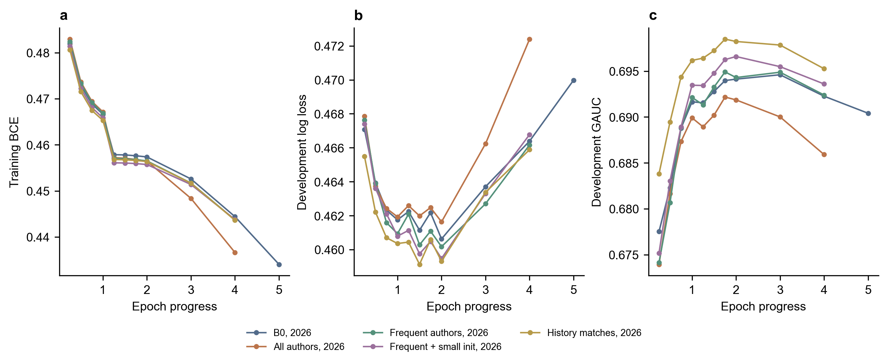
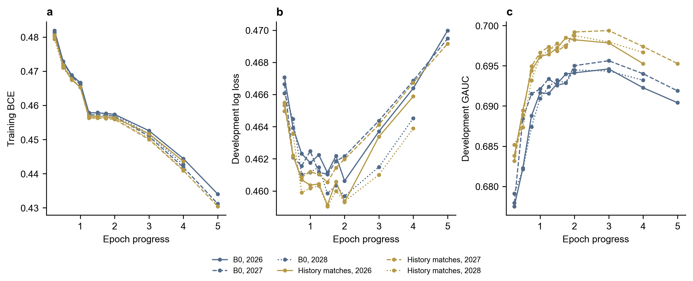

# 推荐算法第二轮优化总结

本轮完成Pure场景一致性诊断，以及1K作者频次、初始化和显式历史匹配对照。

## 结果与采用方案

1K曝光预测实验优先采用显式历史匹配，三种子平均测试GAUC由0.69076升至0.69377，变化及95%区间为+0.300 [+0.220, +0.380]个百分点。Pure页面继续使用RRF排序。

场景一致后，融合尚未同时获得两个Top10指标区间下界均大于0的结果。当前证据支持保留RRF，停止在此诊断阶段。

## 1. Pure场景一致性诊断

复用现有观看模型，开发曝光按用户、日期、场景分组，比较真实场景与固定tab=0。

| 输入场景 | 有效组 | 曝光数 | GAUC | NDCG@10 |
| --- | ---: | ---: | ---: | ---: |
| 真实场景 | 2,166 | 7,324 | 0.57517 | 0.79676 |
| 固定tab=0 | 2,166 | 7,324 | 0.55852 | 0.79067 |

真实场景的组内GAUC变化为+1.666个百分点，用户配对95%区间[+0.291, +3.018]。

曝光组只纳入正负均有的组，GAUC按曝光数加权，NDCG组间等权并处理并列分数。曝光有效组中位数为3条，不能把其NDCG与100候选口径直接对比。

固定候选评价把用户日期查询拆成实际出现的场景，同组100条候选都使用该场景，正例也限定在该场景。下表只统计有正例的场景查询。

| 排序 | 场景查询数 | Recall@10 | NDCG@10 | 内容覆盖率 |
| --- | ---: | ---: | ---: | ---: |
| 原RRF | 5,592 | 4.535% | 0.02311 | 55.00% |
| 观看模型 | 5,592 | 3.170% | 0.01623 | 24.44% |
| 75/25融合 | 5,592 | 4.759% | 0.02376 | 49.12% |

该补充评价与旧全场景评价的查询和分母不同，数值分别解释。候选未曝光代表反馈未知；Pure未开展新训练，也未评价测试集。

## 2. 1K配对对照

五组共用训练曝光、batch size 256、Adam学习率0.001和最多5轮训练。前两轮按每四分之一轮检查开发指标，此后每轮检查；按开发GAUC保存最佳点，连续两轮没有更好结果则结束。

B0与新增特征方案的共享参数使用一致初始化，新增输入列初始权重为0。作者按正式训练曝光计数，高频组保留至少101次的作者，其余回退为零；小初始化组将作者embedding标准差设为0.0001。显式匹配组增加3个历史匹配数值，不增加作者embedding表。

下表为种子2026。用户×场景GAUC按user_id与tab分组，跨日期汇总；主GAUC按用户分组。差值和区间以本轮B0为参照。

| 方案 | 开发GAUC | 用户×场景GAUC | GAUC差值及95%区间（百分点） | 参数量 | 最佳训练进度／步数 |
| --- | ---: | ---: | --- | ---: | --- |
| B0对照 | 0.69461 | 0.60913 | — | 54,780,513 | 3.000轮／44,118 |
| 全部训练作者 | 0.69218 | 0.60345 | -0.243 [-0.341, -0.143] | 65,702,209 | 1.750轮／25,736 |
| 高频作者 | 0.69492 | 0.60798 | +0.031 [-0.063, +0.123] | 54,835,665 | 1.750轮／25,736 |
| 高频作者＋小初始化 | 0.69659 | 0.61151 | +0.199 [+0.105, +0.288] | 54,835,665 | 2.000轮／29,412 |
| 显式历史匹配 | 0.69849 | 0.61467 | +0.388 [+0.289, +0.490] | 54,780,705 | 1.750轮／25,736 |

旧B0按整轮评价，种子2026选中第3轮，开发GAUC为0.69461；本轮B0选中3.000轮、步数44,118，开发GAUC为0.69461。轮内评价扩大了可选训练停点，并可能改变早停时机。因此本轮特征增量统一相对本轮B0计算。

### 显式匹配特征的覆盖

| 集合 | 匹配类型 | 非零覆盖率 | 有匹配的观看达标率 | 无匹配的观看达标率 |
| --- | --- | ---: | ---: | ---: |
| 训练 | 同作者 | 1.03% | 33.46% | 26.44% |
| 训练 | 同标签 | 67.94% | 28.47% | 22.38% |
| 开发 | 同作者 | 1.01% | 33.60% | 25.84% |
| 开发 | 同标签 | 67.27% | 27.84% | 21.96% |

开发曝光中，同作者匹配覆盖1.01%，同标签匹配覆盖67.27%。同作者占比和同作者是否出现使用相同的非零样本。表中正例率是未经其他变量调整的观察关联；实际排序增益由模型对照判断。

### 分阶段解释

- 高频作者相对全部作者：开发GAUC差值及95%区间为+0.274 [+0.205, +0.344]个百分点。
- 小初始化相对高频作者默认初始化：开发GAUC差值及95%区间为+0.168 [+0.077, +0.252]个百分点。

高频筛选和初始化对照用于判断作者方案内部的变化；最终是否改善仍以相对B0的主指标为准。

### 训练用时与选中停点

| 方案 | 种子 | 完成轮数 | 累计训练分钟 | 最佳训练进度／步数 |
| --- | ---: | ---: | ---: | --- |
| B0对照 | 2026 | 5 | 31.0 | 3.000轮／44,118 |
| B0对照 | 2027 | 5 | 30.7 | 3.000轮／44,118 |
| B0对照 | 2028 | 4 | 24.5 | 2.000轮／29,412 |
| 全部训练作者 | 2026 | 4 | 29.6 | 1.750轮／25,736 |
| 高频作者 | 2026 | 4 | 25.3 | 1.750轮／25,736 |
| 高频作者＋小初始化 | 2026 | 4 | 25.3 | 2.000轮／29,412 |
| 显式历史匹配 | 2026 | 4 | 26.0 | 1.750轮／25,736 |
| 显式历史匹配 | 2027 | 5 | 32.5 | 3.000轮／44,118 |
| 显式历史匹配 | 2028 | 4 | 26.0 | 2.000轮／29,412 |

以上覆盖全部完成种子，累计训练时间250.9分钟。时间按每轮训练循环累计，数据加载、开发评价、后续对照统计和报告生成另计。

### 训练曲线





图中保留全部实际开发评价点，曲线连接相邻记录。横轴为累计训练轮数；训练BCE是当前轮截至该点的累计均值，开发LogLoss和GAUC来自该点完整开发评价。颜色代表方案，线型代表种子。

### 追加种子与测试

单种子开发GAUC至少增加0.0005且用户配对区间下界大于0，才进入2027、2028复核。三种子各自改善、平均增量达到0.0005且区间下界大于0后，才评价开发选出的方案及其B0对照的测试结果。

| 阶段 | 种子 | B0 GAUC | 候选GAUC | B0用户×场景GAUC | 候选用户×场景GAUC |
| --- | ---: | ---: | ---: | ---: | ---: |
| 开发复核 | 2026 | 0.69461 | 0.69849 | 0.60913 | 0.61467 |
| 开发复核 | 2027 | 0.69563 | 0.69938 | 0.60851 | 0.61543 |
| 开发复核 | 2028 | 0.69448 | 0.69876 | 0.60709 | 0.61553 |
| 测试 | 2026 | 0.69091 | 0.69371 | 0.60557 | 0.60966 |
| 测试 | 2027 | 0.69024 | 0.69331 | 0.60453 | 0.60960 |
| 测试 | 2028 | 0.69113 | 0.69428 | 0.60493 | 0.61125 |

开发复核配对平均GAUC差值及95%区间：+0.397 [+0.321, +0.475]个百分点。

测试配对平均GAUC差值及95%区间：+0.300 [+0.220, +0.380]个百分点。

### 训练出现与未见视频

种子2026开发集，依据同期B0是否训练过该视频ID分组。后四列为GAUC相对B0的变化，单位为百分点。

| 视频分组 | 开发曝光数 | B0 GAUC | 完整作者 | 高频作者 | 高频小初始化 | 历史匹配 |
| --- | ---: | ---: | ---: | ---: | ---: | ---: |
| 训练出现 | 494,742 | 0.67276 | +0.106 | +0.208 | +0.439 | +0.682 |
| 训练未见 | 1,147,481 | 0.70134 | -0.439 | -0.076 | +0.061 | +0.217 |

### 作者训练频次分组

种子2026开发集；各组按用户计算GAUC。后四列为相对同期B0的变化，单位为百分点。

| 作者训练曝光次数 | 开发曝光数 | B0 GAUC | 完整作者 | 高频作者 | 高频小初始化 | 历史匹配 |
| --- | ---: | ---: | ---: | ---: | ---: | ---: |
| 未见或缺失 | 332,116 | 0.72170 | -0.117 | -0.049 | -0.024 | +0.208 |
| 1 | 99,306 | 0.71083 | -0.658 | -0.203 | -0.131 | +0.380 |
| 2-5 | 210,521 | 0.70694 | -0.546 | -0.040 | +0.017 | +0.336 |
| 6-20 | 331,282 | 0.68762 | -0.442 | -0.124 | -0.004 | +0.354 |
| 21-100 | 415,487 | 0.66497 | -0.127 | -0.089 | -0.041 | +0.397 |
| >100 | 253,511 | 0.65472 | +0.255 | +0.403 | +1.114 | +0.355 |

### 本轮对效果下降的解释

完整作者表加入大量只出现几次的ID，训练BCE下降更快，开发GAUC却更差；低频作者组和训练未见视频组均出现退化。频次筛选缩小了作者表，再减小初始化尺度后，作者方案获得正向结果。这说明作者特征的效果依赖于低频回退和初始化方式。

显式历史匹配直接表达候选与已有兴趣的关系，三列分别为历史同作者占比、是否存在同作者、共享候选标签的历史占比。所有列只读取该请求之前有效的历史，空历史返回0，缺失作者和未知标签不计为匹配。它增加192个权重，六个作者频次组、训练出现与未见视频组的开发GAUC点估计均改善；三列各自贡献需要单独消融才能区分。

Pure的真实场景输入改善了曝光组内GAUC，但观看模型在100候选排序中仍不如RRF。场景修正解决了一部分输入不一致，曝光分类训练与召回候选排序的目标、样本分布差异仍然存在。本轮据此保留RRF，不追加新排序器。

## 3. 代码与复现

`sequence_model.py`增加可选的配对初始化和3维匹配输入；`sequence_training.py`增加作者频次筛选、作者初始化尺度、匹配特征计算，以及轮内开发评价和检查点记录。原配置仍可按原默认行为运行。

47项测试通过，覆盖公共参数与初始预测一致、频次100/101边界、缺失值与空历史、反馈延迟、最佳轮内检查点恢复及整轮早停。新旧默认模型的B0/B1/B2初始化也已逐项核对。

在项目根目录执行，训练使用具备CUDA的Python环境，报告生成需要matplotlib。

```powershell
$env:PYTHONPATH = "$PWD\src"
python -m unittest discover -s tests -p "test_*.py"
python scripts/evaluate_pure_scenes.py
python scripts/run_author_followup.py
python scripts/audit_followup_matches.py
python scripts/audit_followup_author_groups.py
python scripts/report_author_followup.py
```

实验入口复用相同配置下已完成的训练结果。新模型与映射位于artifacts/kuairand_1k/author_v2，各方案独立保存；原模型继续保留。

## 4. 结果与数据

配对区间均按用户整体抽样2000次，保留同一用户的观测关系。1K多种子时平均配对差值。区间描述已训练模型下的用户差异；既有测试集用于本项目回顾性比较。

- [Pure诊断说明](pure_scene/report.md)
- [Pure完整结果](pure_scene/results.json)
- [1K完整比较与分组结果](sequence/comparison.json)
- [指标CSV](author_metrics.csv)
- [显式匹配覆盖与正例率](match_coverage.json)
- [作者训练频次分组](author_groups.json)
- [全部实际评价点CSV](training_curves.csv)
- [Pure指标CSV](pure_scene_metrics.csv)
- [代码与文件检查](verification.json)

### 使用本轮1K模型

完整配置为`artifacts/kuairand_1k/author_v2/configs/history_matches.yaml`，模型为该方案目录下`B0_seed2026/best.pt`；2027、2028模型用于配对复核。检查点同时保存`spec`、`mode`、`model_kwargs`和权重，重建模型时需一并读取。`run_author_followup.py`中的测试回放展示了完整加载与预测流程。

1K模型用于曝光预测实验，Pure演示页面仍读取Pure候选和模型。
